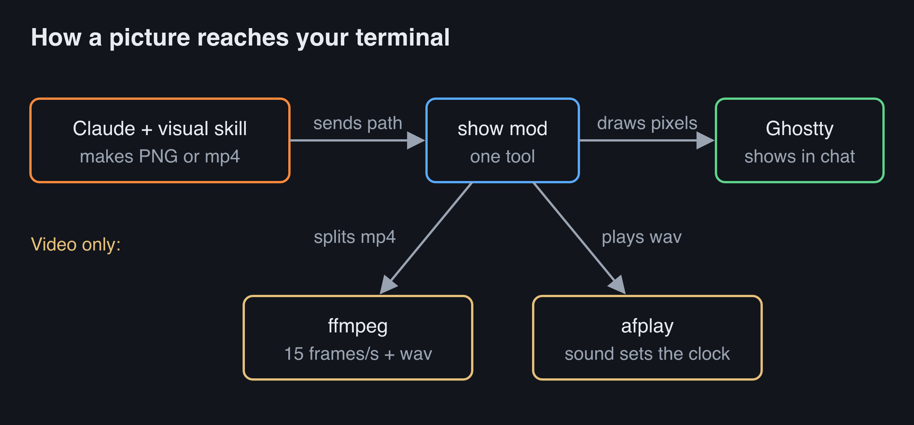

# show

Claude Code can now show you pictures in the chat. Ask it how DNS works, and a diagram appears in the conversation, right where Claude explains it. Ask for a video, and a narrated explainer plays in the chat with sound. There is no browser tab and no HTML page.



A one-minute narrated video shows how it works: [docs/claude-show.mp4](docs/claude-show.mp4).

It is one Claude Code plugin with two parts:

- A mod that adds the tool `mcp__show__media`. Claude calls it with the path of a PNG or an mp4. A PNG shows at once. An mp4 plays with sound, and the call returns when the video ends.
- A skill, `show:visual`, that tells Claude how to make the picture. A diagram is an SVG that resvg turns into a PNG in about 0.2 seconds. A video gets a script, a local Kokoro voice, and Manim animation, all offline.

## What you need

- macOS. The sound plays through `afplay`.
- Ghostty or kitty. Both draw real pixels with the kitty graphics protocol. Pictures do not show through tmux.
- `ffmpeg`, `ffprobe`, and `xxd` on your `PATH`.
- `uv`, which the skill uses to run resvg, Kokoro, and Manim.
- A Claude Code build with mods. I tested it on 2.1.296.

## Install

```
/plugin marketplace add stevenc81/claude-plugins
/plugin install show@stevenc81
/reload-plugins
```

To try a change before you push it, start Claude Code from the repository root with the plugin loaded from your working tree:

```
claude --plugin-dir ./plugins/show
```

The first image or video downloads Python packages through `uv`. The first video also downloads the Kokoro voice model, which takes about 5 minutes.

## Using it

Ask for a picture in plain words: "draw me how the request flows", or "make a video about how DNS works". While a video plays:

- Type `/pause` to pause, and `/pause` again to resume.
- Press Esc to stop it.

## How a video plays

The mod does not stream the video. It prepares it first:

1. ffmpeg splits the mp4 into 15 PNG frames per second, 960 pixels wide, plus a wav file.
2. `afplay` plays the wav.
3. A timer reads how long the sound has played and swaps in the frame for that moment.

The picture follows the sound, so the two stay in sync for the whole video. `/pause` stops `afplay`. Resume cuts the wav at the paused point and starts `afplay` again.

A 3-minute video takes about 5 seconds to prepare. Its frames use about 300 MB under `claude-show` in your private temp folder (`getconf DARWIN_USER_TEMP_DIR`), and the mod deletes them when the video ends.

## Limits

- macOS only, because of `afplay`.
- One video plays at a time. There is no seek.
- The skill gets its Python packages from PyPI through `uv`. Every package, including indirect ones, has an exact version in `skills/visual/scripts/*.lock.txt`, and the Kokoro model has a fixed Hugging Face revision. There are no hashes, because `uv run` does not check them, so a replaced file under the same version would not be caught. Build tools for the packages that build from source (pycairo, srt, docopt) are fixed in `build.lock.txt`; `uv run` ignores build constraints, so `setup.sh` (run once per machine, online) builds them with `uv pip install` first and `uv run` reuses the built wheels from the cache. To update, edit the matching `.txt` file and run the `uv pip compile` command at the top of its `.lock.txt` file.
- The picture size assumes a terminal cell twice as tall as it is wide, which fits Iosevka in Ghostty. If a circle shows as an oval, change `CELL_ASPECT` in `hooks/register.tsx`.

## Tests

Run this from `plugins/show`:

```
claude plugin test .
```

The tests check the PNG header reader, the picture size math, the frame clock, and how the tool refuses bad input. Video playback was tested by hand: a 10-second counter video with a beep each second stayed in sync, and pause and resume kept it in sync.
